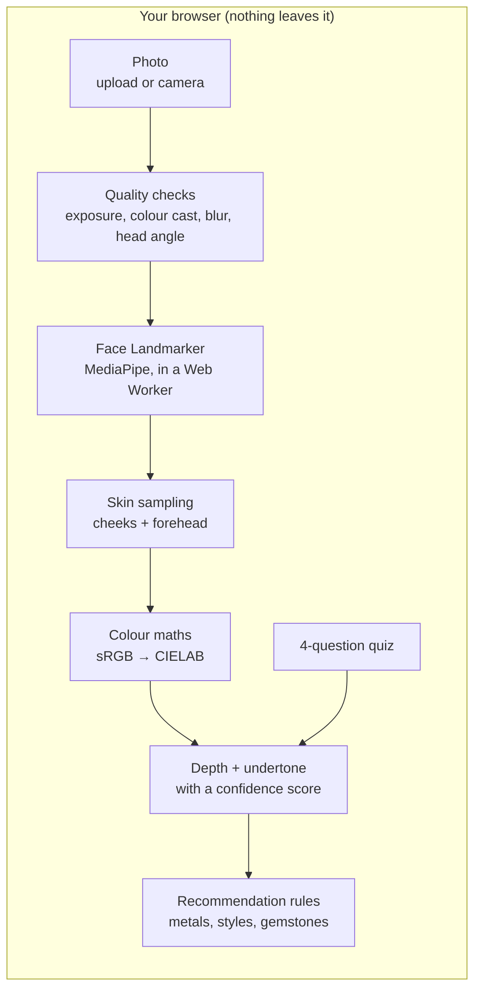

# ToneMatch

[](https://github.com/FabianHaxhiaj22/tonematch/actions/workflows/ci.yml)

**Find the jewellery metals that suit your skin tone, from a selfie analysed entirely in your browser.**

ToneMatch reads the **depth** (light → deep) and **undertone** (cool, neutral or warm) of your skin from a photo, combines it with four quick questions, and suggests jewellery metals (yellow, rose and white gold, silver, platinum, mixed metals), styles for rings, earrings, necklaces and bracelets, and gemstones that go with them. Every suggestion comes with a short reason and a confidence score.

## Privacy first

- **Your photo never leaves your device.** Face detection and colour analysis run in the browser (WebAssembly in a Web Worker). Nothing is uploaded or stored.
- The face model and its runtime are **self-hosted** and checksum-verified, so no third-party server is contacted at runtime.
- No accounts, no tracking of results. A planned, opt-in AI explanation would only ever receive numbers (colour values and quiz answers), never an image.

## How it works

The analysis pipeline below is implemented and tested; the screens around it (the upload/camera page and the results page) are the next milestones (see [Project status](#project-status)).



1. **Quality checks** flag photos that are too dark or bright, colour-cast, blurry, too small or taken with the head turned. A photo without exactly one face is rejected; other warnings can be overridden but lower the confidence.
2. **MediaPipe Face Landmarker** finds 478 face landmarks; skin is sampled from both cheeks and the forehead, away from eyes, brows, lips and hair, with outliers (shadows, highlights, blemishes) filtered out.
3. The colour engine converts the samples to **CIELAB**. **Depth** comes mostly from lightness and is expressed as an approximate value on the [Monk Skin Tone scale](https://skintone.google/); **undertone** comes from the hue angle.
4. A short **quiz** (vein colour, skin in daylight, gold vs silver, white vs cream) is combined with the photo. When the two disagree, or the photo is unclear, confidence drops and the result says so.
5. A **rules engine** over validated JSON data turns the result into metal tiers (best, also good, use with care), style suggestions and gemstones. When it isn't confident, it shows both warm and cool metals instead of guessing.

## Honest limitations

- **This is style guidance, not a measurement of you.** "Warm suits gold, cool suits silver" is a styling convention, not science.
- **Lighting and cameras change the result.** Auto white balance, filters and room light shift skin colour; an optional white-paper calibration (part of the upcoming camera flow) helps. The confidence score reflects how much the photo can be trusted.
- **Makeup on the cheeks** (blush, bronzer) changes the sampled colour.
- **ToneMatch never infers, labels or stores race or ethnicity.** Skin tone is not race.
- Thresholds are documented starting values, still to be calibrated with consenting volunteers.

## Tech stack

Next.js 16 (App Router) · React 19 · TypeScript (strict) · Tailwind CSS 4 · MediaPipe Tasks Vision · Zod · Zustand · Vitest + Testing Library · Playwright + axe · pnpm · GitHub Actions

## Project status

Current release: **v0.2.0**. The analysis and recommendation core is built and tested, and the landing page with photo upload is built; the full flow to the results page comes next.

- [x] Repository, tooling, CI and release automation
- [x] Colour engine (sRGB → CIELAB, chroma, hue, ITA)
- [x] Face Landmarker in a Web Worker
- [x] Skin sampling, photo quality checks and white-balance maths
- [x] Depth, undertone and confidence scoring, plus the undertone quiz (English and Albanian)
- [x] Recommendation engine and data (metals, styles, gemstones)
- [x] Visual design, site layout and landing page with photo upload (English and Albanian)
- [ ] Full flow from photo to results page, and shareable result card
- [ ] Live camera capture and white-paper calibration flow
- [ ] Full English/Albanian interface, accessibility pass and privacy page
- [ ] Public deployment and v1.0.0
- [ ] Later: face-shape advice, AR try-on preview, optional AI explanation (numbers only), multi-photo averaging

> **Screenshots and a live demo** will be added with the results page and the first public deployment.

## Getting started

**Prerequisites:** Node.js 24 (see `.nvmrc`), pnpm 12 via Corepack, and Git.

```bash
git clone https://github.com/FabianHaxhiaj22/tonematch.git
cd tonematch
corepack enable pnpm
pnpm install
pnpm dev
```

`pnpm dev` first fetches and verifies the MediaPipe files (a ~3.8 MB face model plus the WASM runtime from the installed package), then starts the app at http://localhost:3000. The quiz is at `/quiz`; a landmark debug page at `/dev/landmarks` exists in development only.

Checks, as in CI: `pnpm lint` · `pnpm typecheck` · `pnpm validate:data` · `pnpm test` · `pnpm build` · `pnpm e2e`

Full developer setup (Windows notes, git identity, workflow): [docs/ONBOARDING.md](docs/ONBOARDING.md).

## Engineering highlights

- **CI on every pull request:** lint, formatting, type check, data validation, unit tests, production build and Playwright end-to-end tests with axe accessibility checks.
- **Coverage gate:** the pure logic in `src/lib` must keep at least 90% line, branch, function and statement coverage, or CI fails.
- **Protected `main`:** pull requests only, required checks, linear history, no force pushes, for admins too.
- **Releases with release-please:** Conventional Commits drive the version, the changelog and GitHub Releases ([CHANGELOG](CHANGELOG.md)).
- **Dependabot** for npm and GitHub Actions updates, with security alerts, secret scanning and push protection on.
- **Pinned and verified dependencies:** exact versions, actions pinned to commit SHAs, checksums for the self-hosted model files.
- **Documented decisions:** every non-obvious choice is logged with its reasons and alternatives in [docs/DECISIONS.md](docs/DECISIONS.md); thresholds and how they were chosen are in [docs/CALIBRATION.md](docs/CALIBRATION.md).
- The full build specification is [docs/SPEC.md](docs/SPEC.md).

## Authors

- **Fabian Haxhiaj** · [@FabianHaxhiaj22](https://github.com/FabianHaxhiaj22)
- **Erdiona Tola** · [@tolaerdiona-commits](https://github.com/tolaerdiona-commits)

## Licence

**All rights reserved.** This repository is public so the code can be viewed; no open-source licence is granted.
